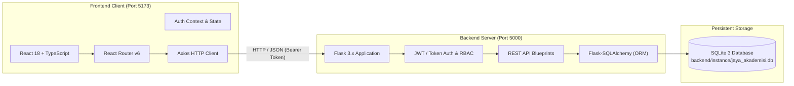

# System Design Document

## 1. System Architecture
Jaya Akademisi is designed as a decoupled two-tier client-server architecture.

## 2. API Design Principles
- Standard RESTful conventions with JSON payloads.
- Status codes: `200 OK`, `201 Created`, `400 Bad Request`, `401 Unauthorized`, `403 Forbidden`, `404 Not Found`, `500 Server Error`.
- Authentication via HTTP Authorization header: `Bearer <token>`.
- Cross-Origin Resource Sharing (CORS) configured to permit requests from `http://localhost:5173`.
