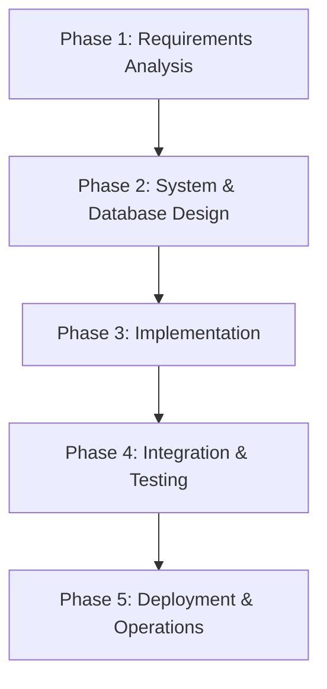

# Waterfall Development Methodology

Jaya Akademisi is developed strictly adhering to the classical **Waterfall Software Development Life Cycle (SDLC)**. Each phase has defined objectives, inputs, deliverables, and validation criteria.

## Phase Breakdown

### Phase 1: Requirements Analysis
- **Goal**: Gather and formalize functional, non-functional, and academic domain requirements for Universitas Pembangunan Jaya.
- **Deliverables**: `docs/REQUIREMENTS-ANALYSIS.md`, `docs/phases/PHASE-01-REQUIREMENTS.md`.

### Phase 2: System Design
- **Goal**: Define system architecture, relational database schema, Entity Relationship Diagrams (ERD), Use Case Diagrams, and Data Flow Diagrams (DFD Level 0 & Level 1).
- **Deliverables**: `docs/SYSTEM-DESIGN.md`, `docs/DATABASE-DESIGN.md`, `docs/ERD.md`, `docs/USE-CASE.md`, `docs/DFD.md`, `docs/phases/PHASE-02-SYSTEM-DESIGN.md`.

### Phase 3: Implementation
- **Goal**: Code the Flask REST API backend, SQLAlchemy SQLite database models, seed script, and Vite React TypeScript frontend.
- **Deliverables**: Source code in `backend/` and `frontend/`, `docs/phases/PHASE-03-IMPLEMENTATION.md`.

### Phase 4: Integration and Testing
- **Goal**: Perform comprehensive testing (API unit tests, integration tests, end-to-end user workflow validation, and UI verification).
- **Deliverables**: `docs/TESTING-REPORT.md`, `docs/phases/PHASE-04-TESTING.md`.

### Phase 5: Deployment and Documentation
- **Goal**: Package localhost startup scripts, finalize user documentation, verify database persistence, and document operations.
- **Deliverables**: `start.sh`, `README.md`, `docs/DEPLOYMENT-GUIDE.md`, `docs/phases/PHASE-05-DEPLOYMENT.md`.
